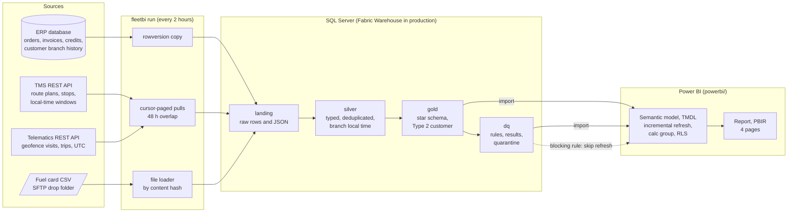

# fleet-delivery-powerbi

Delivery performance, fleet cost and customer profitability for a distributor that runs its own refrigerated trucks, from source systems to a Power BI semantic model and report. Python extracts pull a TMS and a telematics API incrementally, copy ERP tables by rowversion watermark and pick up fuel card files. T-SQL procedures build a typed silver layer, a star schema and a set of data-quality rules. A semantic model defined in TMDL (Import mode, incremental refresh, a time-intelligence calculation group and dynamic row-level security) sits on top, with a four-page PBIR report. The model refreshes as the last step of a run and only if no blocking rule fired.

This is a reference implementation of the architecture behind a platform I built for a mid-sized foodservice distributor. The production build is under NDA, so a few integrations are abstracted behind adapters: Fabric Data Factory pipelines and notebooks became a Python package, the Lakehouse and Warehouse became a SQL Server container, and the Power BI service refresh is a REST adapter. It runs on synthetic data, and every company, place, person, phone number and figure in it is made up.

[](https://github.com/AlexKurinets/fleet-delivery-powerbi/actions/workflows/ci.yml)

## Architecture



The Compose stack runs three services: `sqlserver` (the warehouse, plus a second database standing in for the ERP), `sources` (mock TMS and telematics APIs over the synthetic world) and `pipeline` (init, seed, then a run every two hours). The report is the dashboard; it lives in `powerbi/` as a Power BI Project and reads the same `gold`, `rpt` and `sec` objects everything else does.

## Design decisions

**Score delivery on the system that observed it.** The TMS "delivered" time is typed by the driver, and drivers who fall behind tend to skip the tap and enter an in-window time at the end of the shift. On-time is scored on the telematics geofence arrival, with the TMS time only as a fallback flagged in `Arrival Source` (`sql/dw/03_gold.sql`, `gold.load_fact_delivery_stop`). A stop counts as back-filled when its TMS entry was recorded more than 60 minutes after the truck left the geofence. On the full synthetic history the TMS time says 93.6% on time and the geofence says 86.0%; the model keeps both (`On-Time %` and `On-Time % (TMS Time)`) so the gap is visible on the Data Health page.

**Convert time zones once, in silver.** The TMS sends windows and delivered times in branch local time with no offset, and telematics sends UTC. `silver.load_api` converts telematics to the local time of the truck's home branch with `AT TIME ZONE` before anything is compared, and gold stores minutes after local midnight. Two of the six branches are on Mountain time, and `tests/test_incremental.py` checks stops on both sides of the November daylight saving change against the generator's ground truth.

**Page on a cursor, re-read an overlap, keep the latest version.** `src/fleetbi/extract/api.py` pages on the API's `(updated_at, id)` cursor from the stored watermark minus 48 hours and lands every record as the API returned it in `landing.api_record`. Offset paging skips one record and repeats another when a stop is edited mid-pull; `tests/test_sources_api.py` reproduces that against the mock API and shows the cursor pull misses nothing. Silver keeps the newest version of each record, so the overlap and the repeat cost a few landing rows and never a duplicate stop.

**Rebuild only the dates a run touched.** Silver records the operating dates its changed rows belong to in `meta.affected_date`, and every gold fact deletes and reinserts exactly those dates, the way the model's incremental refresh reprocesses only its recent partitions. A run with nothing new rebuilds the last few days from the overlap re-read; a customer whose branch history changes re-keys every date that customer appears on.

**Two fact grains, never one wide table.** Stops (`gold.fact_delivery_stop`) and invoice lines (`gold.fact_invoice_line`) are separate facts that share Date, Branch, Customer and Route, so slicing by product category filters invoice lines without multiplying stops. Credits for short and refused cases arrive as negative invoice lines one to five days later and stay at their posting date for revenue; in-full comes from the cases recorded at the stop, after corrections.

**Type 2 customers, keyed by the ERP's branch history.** Customers move between branches when routes are rebalanced. `gold.load_dims` builds one `dim_customer` row per branch period from the ERP's assignment history, with stable integer keys (no `IDENTITY`), and facts look up the version valid on their date. The seed moves three customers on 2 November 2026, which you see by running `fleetbi advance --days 3`.

**Compute in SQL, keep the model narrow.** The model has no calculated columns or tables. Keys are integers, datetimes are split into a date key and a minute of day, and the TMS GUIDs stay in the warehouse (`stop_id` is selected out in the partition query). Every measure has a description, a format string and a display folder, and `DIVIDE` instead of `/`. The two large facts have an incremental refresh policy (three years kept, last ten days refreshed) filtered on `RangeStart` and `RangeEnd`, and every partition reads through the `SqlServer` and `SqlDatabase` parameters so a deployment rule can point each stage at its own warehouse.

**Dynamic RLS without bidirectional filters.** The `Branch Manager` role filters `Branch` with a lookup of `USERPRINCIPALNAME()` in the hidden `Security Branch Access` table, which has no relationships. `All Branches` is the unfiltered role for executives and finance. Route, Driver and Truck are not related to Branch, so each fact has one filter path from Branch and no ambiguity.

**Data quality is on the page and gates the refresh.** `dq.run_rules` writes one row per rule, branch and day: geofence coverage, back-filled TMS entries and delivery orders without a TMS stop (each over the trailing seven days, because a synthetic branch makes about 30 stops a day), arrivals before dispatch (those stops are quarantined, not loaded), fuel bought on a day the truck wasn't routed, and source freshness. The Data Health page reads the same table. `ARRIVAL_BEFORE_DISPATCH` is a blocking rule: if more than 2% of a run's stops fail it, the run ends `blocked` and the model refresh is skipped (`src/fleetbi/pipeline.py`).

**The model is code, checked by Microsoft's own library.** `tools/TmdlCheck` loads the TMDL with the Tabular Object Model (`Microsoft.AnalysisServices`, the library Power BI and Fabric use), fails on any syntax or reference error with the file and line, and writes `build/model.bim`. The best-practice rules in `src/fleetbi/model.py` run on that file in CI (no bidirectional relationships, hidden keys, no calculated columns, incremental refresh on the large facts, the RLS lookup, and so on), tests break a copy of the model in eight ways to prove the rules fire, and a test checks every model column against the warehouse's `INFORMATION_SCHEMA` so a renamed SQL column fails CI instead of a refresh. `docs/data-dictionary.md` is generated from the same file, and CI fails if it is stale.

## What the synthetic data shows

After `docker compose up` the warehouse holds 13 months (1 October 2025 to 30 October 2026) for six branches, 24 trucks and 18 routes:

| | |
| --- | --- |
| Delivery stops loaded | 62,594, plus 117 quarantined for a geofence arrival before dispatch |
| On-time, geofence arrival | 86.0% |
| On-time, driver-entered TMS time | 93.6% |
| In-full / OTIF | 86.8% / 74.7% |
| TMS entries flagged as back-filled | 11.7% of geofenced stops (the generator back-fills about 13%) |
| Stops with a geofence arrival | 97.8% |
| Invoice and credit lines | 228,292 |
| Customer versions | 428 for 420 customers (8 moved branch in March 2026) |

`fleetbi kpi --month 2026-10` prints the reconciliation view for a month; the same numbers come out of `powerbi/reconcile/kpi_branch_month.dax` in the model. Redstone Mesa stands out on the Data Health page from mid-August, when one truck's telematics unit starts dropping most geofence events. The synthetic figures are cleaner than production's: the 60-minute back-fill rule never flags an honest entry here, while in production it also caught some drivers who were held at a dock.

## Running it

You need Docker. Host ports default to 14330 (SQL Server) and 8230 (mock APIs); set `SQL_PORT` or `SOURCES_PORT` to change them.

```bash
docker compose up -d --build --wait
docker compose exec pipeline fleetbi status
docker compose exec pipeline fleetbi kpi --month 2026-10
docker compose exec pipeline fleetbi dq
```

The first start creates both databases, seeds the ERP and the fuel files, and runs the pipeline once, which takes a few minutes. To watch an incremental run, move the synthetic clock forward (this crosses the daylight saving change and the 2 November branch move) and run again:

```bash
docker compose exec pipeline fleetbi advance --days 3
docker compose exec pipeline fleetbi run
docker compose exec pipeline fleetbi status
```

### Opening the report

On Windows with Power BI Desktop (September 2026 or later, since the report uses the current PBIR schemas), open `powerbi/FleetDelivery.pbip`. Set the `SqlServer` parameter to `localhost,14330` and `SqlDatabase` to `fleetdw` (Transform data, Edit parameters), sign in with the database credentials `sa` and the password from `docker-compose.yml`, and refresh. The report pages are Delivery Performance, Fleet Cost, Customer Profitability and Data Health. To see row-level security, use Modeling, View as, choose `Branch Manager` and enter `hal.manager@example.com` or `mountain.regional@example.com` as the other user.

### Without Docker

```bash
pip install -e ".[dev]"
fleetbi init && fleetbi seed      # needs a SQL Server; FLEETBI_SQL_HOST, FLEETBI_SQL_PORT, FLEETBI_SQL_PASSWORD
fleetbi serve-sources --port 8230 &
fleetbi run
```

## Tests

```bash
dotnet run -c Release --project tools/TmdlCheck -- powerbi/FleetDelivery.SemanticModel/definition build/model.bim
fleetbi model bpa
fleetbi model docs
FLEETBI_TEST_SQL_PORT=14331 pytest -q
```

The database tests create their own databases on any SQL Server you point them at (CI uses a service container) and check the warehouse against the generator's ground truth: every stop's arrival minute and on-time flag, back-fill detection, quarantine, in-full after late corrections, revenue to the ERP, the reconciliation view, an idempotent rerun, the DST change, the Type 2 move, a blocking rule and a failed run. The report tests validate every PBIR file against Microsoft's published JSON schemas and check every field a visual uses against the compiled model. `scripts/smoke.sh` brings up the Compose stack and runs every command under Running it, and the CI test job runs the commands above. CI runs both jobs.

## Layout

```
sql/erp/                 synthetic ERP source tables (rowversion on every table)
sql/dw/                  landing, silver, gold, dq, rpt and sec objects and procedures
src/fleetbi/synth.py     the synthetic world (seeded per route and day)
src/fleetbi/sources/     mock TMS and telematics APIs
src/fleetbi/extract/     ERP copy, API pulls, fuel files
src/fleetbi/pipeline.py  one run: extract, silver, gold, rules, refresh
src/fleetbi/refresh.py   refresh adapters (log, Power BI REST)
src/fleetbi/model.py     best-practice rules and the data dictionary
powerbi/                 FleetDelivery.pbip, the TMDL semantic model, the PBIR report, reconciliation queries
tools/TmdlCheck/         TMDL to model.bim with the Tabular Object Model
docs/data-dictionary.md  generated from the model
```

## What is deliberately left out

The Fabric items themselves (Data Factory pipelines, notebooks, the Lakehouse), the on-premises data gateway, workspace and deployment pipeline configuration, scheduled refresh settings in the service, and the Power Automate flow that posts failures to Teams. The pipeline, warehouse and refresh adapter here play those parts. The Power BI REST refresh call is tested against a mock transport and has not been run against a workspace from this repo. No open-source engine evaluates DAX, so CI checks the measures structurally and checks the warehouse view they reconcile to, and the DAX query in `powerbi/reconcile/` is the manual check after a refresh in Desktop. Role memberships are assigned in the service, not in the model.

## License

MIT, Alex Kurinets.
